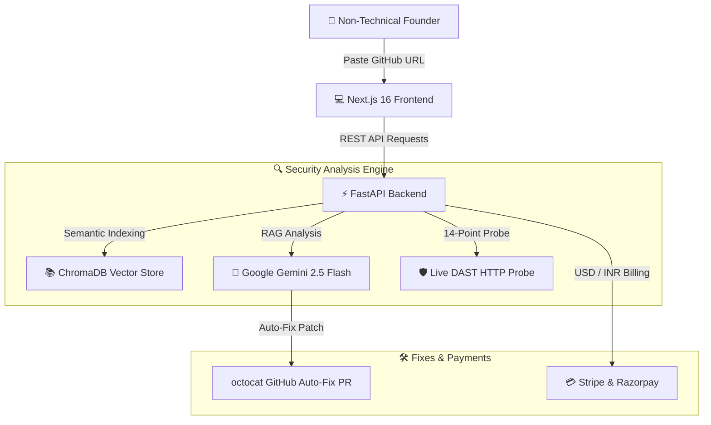

# 🟢 repo_buddy

**CTO in a Box & Security Intelligence Platform for AI-Built Applications**

[](https://opensource.org/licenses/MIT)
[](https://nextjs.org/)
[](https://fastapi.tiangolo.com/)
[](https://aistudio.google.com/)
[]()

> **Paste repository URL → Analyze security risks → Live DAST Probes → Automated PR Fixes.**

**repo_buddy** is an enterprise-grade security intelligence platform engineered specifically for AI-assisted software development. It scans GitHub repositories built with platforms like **Lovable**, **Bolt.new**, or **Cursor**, transforming complex vulnerability vectors into non-technical, plain-English business risks, live proof-of-exploit demonstrations, and automated AI pull requests to patch security holes in production.

---

## 🎯 The Problem

Founders shipping products with modern AI code generation tools launch at unprecedented speeds. However, most non-technical founders lack a CTO, security engineer, or dedicated DevOps team. 
- Traditional scanners produce complex technical reports (*"SQL injection via un-parameterized ORM query in line 142"*).
- Founders need business-impact risk clarity (*"Anyone can download your entire customer database without logging in"*).

**repo_buddy bridges this gap** by converting raw code analysis into actionable security posture scores, real-time DAST HTTP probes, and instant auto-fix PRs.

---

## 🏗️ Architecture Overview



### Stack Components

| Layer | Technologies | Purpose |
| :--- | :--- | :--- |
| **Frontend** | Next.js 16, React 19, TypeScript, Lucide | Responsive security dashboard & shareable report pages |
| **Backend** | FastAPI, Python 3.9+, `slowapi` | High-performance async API server & rate limiting |
| **AI / RAG** | Gemini 2.5 Flash, ChromaDB, HuggingFace | Context-aware code analysis & auto-fix PR generation |
| **Security** | 14-Point DAST HTTP Prober, JWT Auth | Live SSL/CORS/SQLi/XSS checks & encrypted auth |
| **Database** | SQLite (WAL mode) | Low-latency scan result & report persistence |

---

## ⚡ Key Features

- **🧠 RAG Code Analysis**: Clones GitHub repos, embeds code vectors in ChromaDB, and calculates security health scores using Google Gemini 2.5 Flash.
- **🛡️ 14-Point DAST HTTP Probe**: Real-time vulnerability verification (HTTPS enforcement, Security Headers, CORS, SQLi/XSS, IDOR, and exposed secret tokens).
- **🤖 Automated PR Patching**: One-click AI pull request generation to fix discovered vulnerabilities directly on GitHub.
- **💳 Multi-Currency Support**: Automated geo-routing for global payments via **Stripe** (USD) and **Razorpay** (INR).

---

## 🚀 Quick Start Guide

### 1. Backend Setup
```bash
cd backend
python -m venv venv
# Windows: venv\Scripts\activate | Linux/macOS: source venv/bin/activate
pip install -r requirements.txt
cp .env.example .env
python -m app.main
```
*Backend runs at `http://localhost:8000` (API Docs: `/docs`)*

### 2. Frontend Setup
```bash
cd frontend
npm install
cp .env.local.example .env.local
npm run dev
```
*Frontend runs at `http://localhost:3000`*

---

## 👤 Author

**Adhvit Singh**
- **GitHub**: [@Adhvit-Singh](https://github.com/Adhvit-Singh)
- **Repository**: [Adhvit-Singh/repo_buddy](https://github.com/Adhvit-Singh/repo_buddy.git)

---

## 📄 License

Licensed under the [MIT License](LICENSE).


