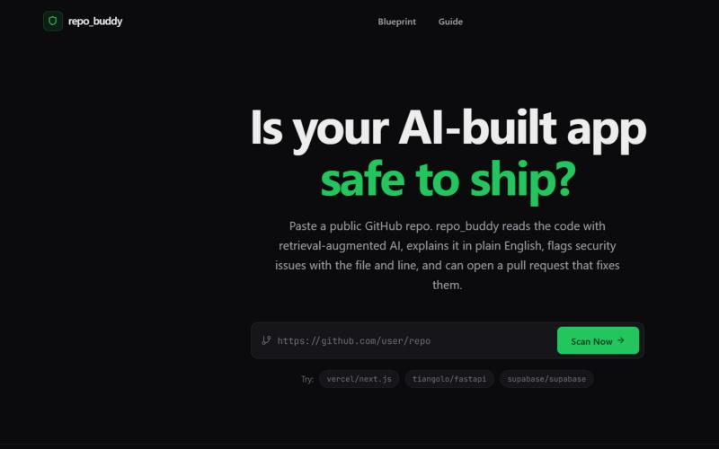
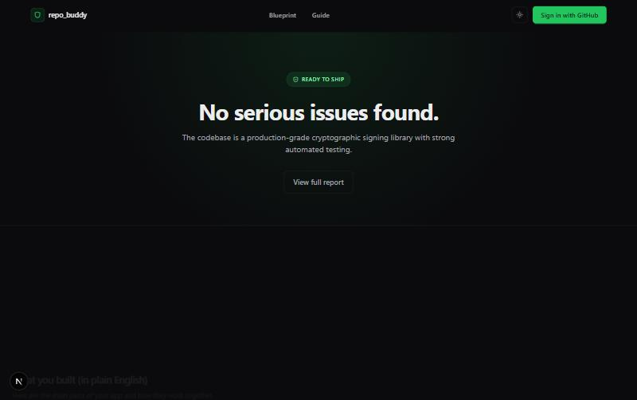
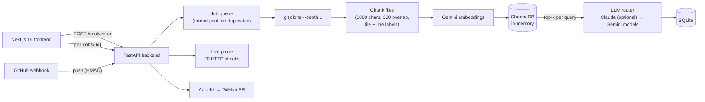

# repo_buddy

**AI security review for apps built with AI coding tools.** Paste a public GitHub repo and repo_buddy reads the code with retrieval-augmented generation (RAG), explains the app in plain English, lists security issues with the file and line they come from, and can open a pull request that fixes them. Point it at a deployed URL and it also runs 20 passive HTTP checks against the live app.

[](https://github.com/Adhvit-Singh/repo_buddy/actions/workflows/ci.yml)
[](LICENSE)


**Live demo:** <https://repo-buddy.netlify.app> · API: <https://repo-buddy-api.onrender.com/docs>  
<sub>Free-tier hosting: the API sleeps when idle, so the first request can take about a minute to wake it up.</sub>

| Landing page | Scan verdict (real scan of `pallets/itsdangerous`) |
|---|---|
|  |  |

## What it does

| Feature | How it works |
|---|---|
| **Code review** | Clones the repo, splits code into overlapping chunks labelled with file + line range, embeds them with Gemini's embedding model into an in-memory ChromaDB collection, retrieves the most relevant chunks for four security/architecture questions, and asks the LLM for one structured JSON report. |
| **Plain-English report** | Health score (0–100), verdict, findings by severity with file/line and a suggested fix, tech stack, architecture diagram (Mermaid) and data flow. |
| **Live HTTP probe** | 20 read-only checks on a deployed URL: exposed `.env` / `.git`, security headers, CORS, open admin routes, secrets in JS bundles, plus Supabase, Firebase, NextAuth, Clerk, Vercel and Stripe-specific checks. Each result shows the request sent and the response received. |
| **Auto-fix PR** | With GitHub sign-in, asks the LLM for fixed versions of the affected files and opens a PR via the GitHub Git Data API (blob → tree → commit → branch → PR). |
| **Push-triggered scans** | A GitHub webhook (HMAC-verified) re-scans only the changed files on every push. |
| **AI chat** | Ask questions about a scan; answers are grounded in the report. |

## Architecture



**Request flow:** the API answers `POST /api/repos/analyze-url` immediately with a `scan_id` and queues the work. The frontend polls `/api/repos/jobs/{scan_id}` until the scan is complete. Results are cached by commit SHA, so re-scanning an unchanged repo doesn't call the LLM again.

### Design decisions

- **RAG instead of sending the whole repo.** Repos rarely fit in one prompt, and sending everything costs more and dilutes the answer. Each chunk carries a `### path (lines a-b)` header, so the model can cite real locations rather than guess them.
- **One LLM router.** Every AI call goes through `services/llm_router.py`, which tries Claude when a key is set and otherwise walks a list of Gemini models. It retries rate-limit and "overloaded" errors with backoff. Model names come from env vars, so a retired model is a config change, not a code change.
- **Fail loudly.** If no key is set or every model fails, the scan errors with a clear message. It never shows placeholder results.
- **Security of the scanner itself.** Only `https://github.com/owner/repo` URLs are cloned (no local paths, submodules or `file://`). The live probe refuses private, loopback and cloud-metadata IPs, re-checks every redirect (SSRF protection), and is rate-limited per IP. Auto-fix only uses the signed-in user's own GitHub token and may only rewrite files it was given. OAuth uses a `state` check and a one-time handoff code, so the access token never appears in a URL.

## Tech stack

| Layer | Tools |
|---|---|
| Frontend | Next.js 16 (App Router), React 19, TypeScript, Tailwind CSS 4, Mermaid |
| Backend | FastAPI, Pydantic, slowapi (rate limiting), httpx, PyGithub |
| AI | Gemini (generation + `gemini-embedding-001`), optional Anthropic Claude, ChromaDB |
| Data | SQLite (WAL mode) |
| Quality | pytest (80 tests), Vitest + Testing Library, ESLint, GitHub Actions CI |
| Deploy | Docker on Render (backend), Netlify (frontend) — both free tiers |

## Run it locally

You need Python 3.12+, Node 20+, git, and a free Gemini API key from <https://aistudio.google.com/apikey> (no credit card).

```bash
git clone https://github.com/Adhvit-Singh/repo_buddy.git
cd repo_buddy

# backend — http://localhost:8000 (API docs at /docs)
cd backend
python -m venv .venv
source .venv/bin/activate            # Windows: .venv\Scripts\activate
pip install -r requirements.txt
cp .env.example .env                 # then set GEMINI_API_KEY
uvicorn app.main:app --reload

# frontend — http://localhost:3000 (in a second terminal)
cd frontend
cp .env.local.example .env.local
npm install
npm run dev
```

GitHub sign-in (dashboard and auto-fix) is optional. See the comments in `backend/.env.example`.

## Tests

```bash
cd backend && pip install -r requirements-dev.txt && python -m pytest
cd frontend && npm test
```

The backend tests need no network or API keys. They mock DNS, the LLM and GitHub.

## Deploy

Free tiers only: backend as a Docker web service on Render (`render.yaml` blueprint), frontend on Netlify. Step-by-step instructions are in [docs/DEPLOY.md](docs/DEPLOY.md).

## Limitations

- The job queue is an in-process thread pool, so queued scans are lost on restart. The next step would be Redis + RQ.
- SQLite is fine for a single instance but not for several servers writing at once.
- Retrieval sends the top 8 chunks for each of 4 fixed queries, so an issue in a file that is never retrieved can be missed on large repos.
- Findings are LLM-generated: useful for triage, not a replacement for a professional audit.
- On the free Gemini tier, scans can be slow or fail when Google's models are overloaded.

## My role / what I learned

The idea came from watching friends ship apps with Cursor and Lovable without really knowing what was inside them. I wanted something where you paste a repo link and it tells you, in normal words, what's wrong and how to fix it. Getting that to work meant touching pretty much every layer: a Next.js frontend, a FastAPI backend, a RAG pipeline, a live HTTP scanner, the GitHub API, and finally deployment.

What I actually learned from it:

- **Code can break even when you don't touch it.** At one point every scan started failing because Google retired the Gemini models that were hard-coded. The worse part was that the app hid the failure and showed a fake demo report instead. Now model names come from config, and a failure shows a real error. I'm not writing a silent fallback like that again.
- **How RAG works beyond the buzzword.** Chunking with overlap, embeddings, a vector database, top-k retrieval. The bug that taught me the most was that chunks were sent to the model without their file names, so it was basically guessing the line numbers. Adding a `### path (lines a-b)` header to every chunk fixed that.
- **A security tool can have security bugs.** The live probe could be pointed at `localhost` or the cloud metadata IP (SSRF), and the GitHub token showed up in the URL after login. Fixing those taught me more about web security than any lecture did.
- **Dependencies decide where you can deploy.** Swapping local PyTorch embeddings for an API took the install from several GB to around 460 MB. That's the only reason the backend fits on a free server.
- **Tests find bugs you would never go looking for.** Writing the test suite turned up three real bugs. My favourite: a single "→" character in a log line crashed scans on Windows.
- **Free hosting changes under you.** I planned to use Hugging Face Spaces, found out Docker Spaces are paid now, and moved the backend to Render.

If I keep working on it, the next steps are moving the job queue to Redis so scans survive restarts, switching SQLite to Postgres, and making retrieval smarter so big repos don't miss files that never get picked.

Planning notes from the original build are kept in [docs/notes](docs/notes).

## Author

**Adhvit Singh** · [GitHub](https://github.com/Adhvit-Singh)

Licensed under the [MIT License](LICENSE).
